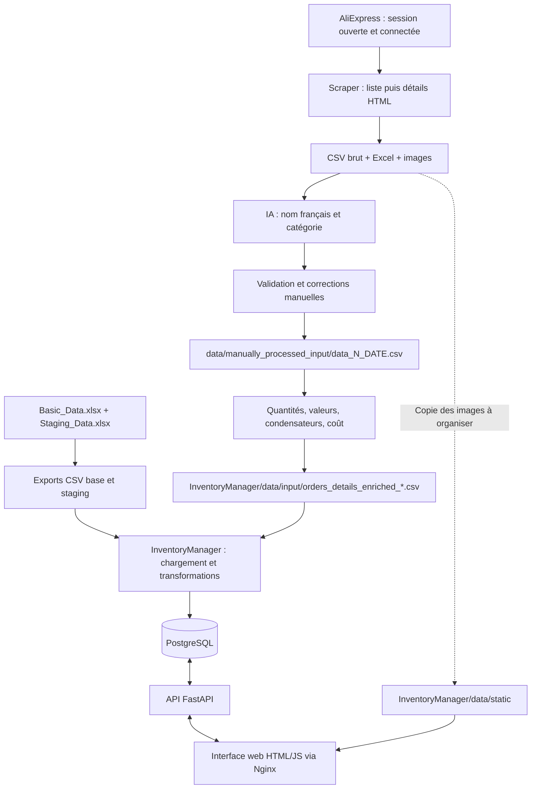

# Fonctionnement actuel d’Inventory

Vérifié le 2026-11-03 contre le code local des trois sous-projets, sur leur branche `linux`. Environnement de développement : Python 3.14 et un `.venv` par projet. Le scraper est adapté à Brave sous Linux via ChromeDriver ; les préférences enregistrées sont Suisse / Berne / Berne-Mittelland / Français / CHF.

## Vue d’ensemble



Le pipeline de traitement est flexible : des fichiers corrigés manuellement peuvent être réinjectés avant n’importe quel étage compatible. Les mécanismes YAML, les étages disponibles et les exemples de reprise sont détaillés aux sections 4.1 à 4.5.

Les traitements ne forment pas un automatisme de bout en bout. Le navigateur connecté, la sélection des lots, les corrections manuelles, la préparation des configurations et la disponibilité des médias restent des étapes distinctes.

## 1. Extraction des commandes

Projet : `aliexpress_orders_exporter`, programme `aliexpress_orders_export.py`.

Le scraper se raccorde à un navigateur déjà ouvert sur la page des commandes AliExpress. La connexion au compte est faite manuellement. Le lanceur `aliexpress_orders_exporter/start_brave.sh` ouvre un profil persistant dédié sous `data/browser/brave-profile`, avec débogage sur `127.0.0.1:9223`. `setup_driver` utilise les options Selenium Chrome avec le binaire Brave ; Selenium Manager résout ChromeDriver et conserve son cache sous `data/browser/selenium-cache`. Les cookies de ce profil conservent la connexion et les préférences enregistrées. Il faut vérifier Suisse / Berne / Berne-Mittelland / Français / CHF avant l’extraction. Le parseur refuse les montants explicitement libellés dans une autre devise ; il ne convertit pas de taux de change.

Les trois étapes s’enchaînent :

1. Déployer la liste des commandes et sauvegarder `data/html/Aliexpress_all_orders_DEBUT_FIN.html`.
2. Visiter les détails des commandes et agréger leurs sections dans `data/html/Aliexpress_all_orders_details_DEBUT_FIN.html`.
3. Lire ce HTML et produire `data/csv/Aliexpress_orders_details_DEBUT_FIN.csv`, sa copie Excel et les images disponibles sous `data/assets/img`.

`--Stage 1` lance les trois étapes ; `--Stage 2` reprend depuis une liste HTML avec `--stage1_html` ; `--Stage 3` reprend depuis les détails HTML avec `--details_html`. Les images peuvent encore nécessiter un téléchargement à cette dernière étape.

`--last_order_date JJ.MM.AAAA` est une borne exclusive : seules les commandes strictement postérieures sont exportées. La date DEBUT du nom est le lendemain de cette borne ; FIN est la date locale du lancement. Le CSV a 14 colonnes, dont `db_item_name` et `db_item_img`, avec séparateur `;`. Le nom des images combine le numéro de commande et un MD5 du nom brut de l’article.

Dernière extraction vérifiée le 2026-11-03 : `aliexpress_orders_exporter/data/csv/Aliexpress_orders_details_20260210_20261103.csv` et `.xlsx`, 23 commandes / 32 lignes, dates réelles du 18.03.2026 au 23.10.2026, montants CHF, toutes les images récupérées. Le rapport `.validation.json` adjacent vérifie la correspondance des identifiants avec la liste capturée et le hash du CSV. Ce nouveau lot est désormais l’entrée du `postprocess.yml` décrit ci-dessous.

## 2. Enrichissement sémantique par IA

Projet : `OrdersPostProcessingPipeline`. Le fichier `postprocess.yml` a été adapté le 2026-11-03 pour le **nouveau lot 4**, avec une passe IA seule avant validation manuelle :

- Entrée : `../aliexpress_orders_exporter/data/csv/Aliexpress_orders_details_20260210_20261103.csv` (32 lignes, fichier brut conservé).
- Parcours sélectionné : `llm_step → ensure_extra_columns → export_csv → export_excel`.
- Fournisseur/modèle explicites : OpenRouter / `deepseek/deepseek-v3.2`.
- Prompt et taxonomie : `pipeline_runner/prompt.md`, non modifié.
- Résultat IA : `db_item_name` en français, `item_tag_code`, `confidence`, métadonnées de suivi/erreur ; colonnes complémentaires `code`, `uuid`, `container_code`, `flag`.
- Checkpoint : `data/checkpoints/Aliexpress_orders_details_20260210_20261103.csv`.
- Sorties de revue prévues : `data/output/Aliexpress_orders_details_20260210_20261103_ai.csv` et `.xlsx`, feuille `Item_Orders`.
- Debug propre au lot : `data/debug_ai_batch_4`.

Les calculs de quantités, valeurs et coûts sont réservés au traitement déterministe après la correction manuelle. La configuration `deepseek.deepseek-v3.2.yml` reste un parcours historique du lot précédent ; elle n’a pas été modifiée. L’ancien `postprocess.yml` déterministe a été conservé sous `data/config_archive/postprocess.before_batch_4_20261103.yml`.

Les appels sont groupés par 20 lignes. `prompt_limit: 100` limite le nombre de lots d’appels, pas le nombre de lignes. Pour reprendre un checkpoint, faire pointer l’entrée `llm_step.input` vers son fichier ; `resume: true` n’ouvre pas automatiquement le checkpoint.

Depuis ce sous-projet, si la clé est déjà héritée par le processus Python :

```bash
.venv/bin/python -m pipeline_runner.pipeline_runner --config postprocess.yml
```

Pour les commandes de cette session agent, le chargement explicite autorisé par l’utilisateur fonctionne en sourçant le fichier privé du domicile **dans le même shell que le programme** :

```bash
. "$HOME/.secrets"
.venv/bin/python -m pipeline_runner.pipeline_runner --config postprocess.yml
```

Le fichier privé `~/.secrets` contient déjà `set -a` et `set +a` pour exporter ses variables : ne pas les répéter autour du chargement. La clé n’est ni affichée ni recopiée dans le projet. Exécuter le chargement puis Python dans deux appels d’outils distincts ne fonctionne pas : chaque commande ouvre un nouveau shell. Pour vérifier la transmission sans afficher de secret, remplacer la dernière ligne par `python3 -c 'import os; print("CLÉ PRÉSENTE" if os.environ.get("OPENROUTER_API_KEY") else "CLÉ ABSENTE")'`.


Les identifiants sont lus depuis les variables d’environnement (prioritaires), `.env`, un fichier ordinaire `.secrets` en syntaxe `KEY=VALUE`, ou `.secrets/.env`. Les identifiants d’InventoryManager utilisent un autre format et un autre chargeur. Le support du fichier ordinaire `.secrets` a été corrigé pendant cet essai.

**État du lot 4 : passe IA terminée et contrôlée le 2026-11-03.** Après un premier échec d’authentification (diagnostic conservé sous `data/failed_runs/ai_batch_4_20261103_authentication`), le chargement de `~/.secrets` dans le même shell que Python a permis la reprise : 32 lignes / 23 commandes, toutes `ai_status=ok`, aucun nom ni code de catégorie manquant, données brutes conservées. Cinq lignes ont une confiance inférieure à 0,8, dont trois classées `Z99-99` ; la correction manuelle reste nécessaire. CSV et Excel sont aux chemins de revue indiqués ci-dessus, avec un rapport `.validation.json` adjacent au CSV. L’utilisateur a ensuite fourni `data/manually_processed_input/data_4_20261103.csv`. Le parcours `pipeline.process_data_4.yml` est exécuté et le lot importé dans PostgreSQL : 32 objets et 32 lignes de commandes ajoutés, sans réimport des anciens lots.

Le fichier `OrdersPostProcessingPipeline/.secrets` reste supprimé. Le pipeline s’arrête sur les erreurs 401/403 en conservant sa progression ; les 61 tests locaux passent. Le chargement de la clé est un problème distinct de l’activation du venv Python.

## 3. Validation manuelle : la source rejouable des commandes

Copier la sortie IA vers `OrdersPostProcessingPipeline/data/manually_processed_input/data_N_YYYYMMDD.csv`, puis contrôler les noms et les codes de catégories. Compléter les informations utiles au rangement (`container_code`) et à l’identification (`code`, `uuid`) si nécessaire. Un `flag` non vide exclut la ligne du traitement de création d’Items à l’import.

Les métadonnées IA (`confidence`, `ai_status`, `ai_error`, `ai_raw_json`) sont conservées comme diagnostic, sans correction manuelle de leur signification.

Quatre lots existent :

| Configuration déterministe    | Source corrigée       | CSV destiné à InventoryManager                  |
| ----------------------------- | --------------------- | ----------------------------------------------- |
| `pipeline.process_data_1.yml` | `data_1_20251211.csv` | `orders_details_enriched_20031121_20251211.csv` |
| `pipeline.process_data_2.yml` | `data_2_20251224.csv` | `orders_details_enriched_20031121_20251224.csv` |
| `pipeline.process_data_3.yml` | `data_3_20260209.csv` | `orders_details_enriched_20251226_20260209.csv` |
| `pipeline.process_data_4.yml` | `data_4_20261103.csv` | `orders_details_enriched_20260210_20261103.csv` |

Le lot 1 utilise historiquement des virgules ; le lecteur du pipeline dispose d’un repli de détection. La convention pour les nouvelles sorties reste `;`.

## 4. Traitement déterministe et livraison des CSV

Chaque `pipeline.process_data_N.yml` fonctionne sans appel IA : suppression des colonnes de debug, calcul des multiplicateurs et quantités, dérivation des valeurs, décodage EIA des condensateurs, traitement des noms de sets et du coût, encodage JSON des listes, exports CSV/Excel. Le lot 1 commence aussi par une normalisation de la colonne `order`.

Le coût par pièce est désormais `item_unit_price × item_quantity / db_item_total_quantity`, avec repli sur les quantités disponibles. La correction du 2026-11-03 évite de diviser deux fois par le nombre d’articles commandés : quatre boîtes à 1,36 CHF restent à 1,36 CHF pièce. Les anciens lots n’ont pas été régénérés à cette occasion.

Depuis `OrdersPostProcessingPipeline` :

```bash
.venv/bin/python -m pipeline_runner.pipeline_runner --config pipeline.process_data_3.yml
```

Le CSV est écrit directement dans le dossier voisin `InventoryManager/data/input`. L’Excel est écrit dans `data/output`, feuille `StgAliItemOrders` selon les configurations actives. `bash process_all.sh` rejoue explicitement les lots 1, 2, 3 et 4 ; il ne découvre pas automatiquement un prochain lot. Ces commandes réécrivent leurs sorties.

### 4.1 Le pipeline est un moteur configurable, pas une chaîne imposée

Le programme `pipeline_runner/pipeline_runner.py` lit un fichier YAML et exécute une sélection de fonctions Python sur un tableau pandas. Une configuration décrit un parcours : un passage IA, un post-traitement complet, une reprise après correction ou un simple export. Le même moteur sert à tous ces usages.

```yaml
pipeline:
  defaults:
    params:
      input_encoding: utf-8
      sep: ";"
  order: [ensure_columns, export_review]
  debug: true
  debug_dir: data/debug_review
  steps:
    - name: ensure_columns
      module: pipeline_runner.steps.ensure_extra_columns.ensure_extra_columns
      input: data/input/mon_lot.csv
      output: "-"
      params: {}
    - name: export_review
      module: pipeline_runner.steps.noop
      input: "-"
      output: data/output/mon_lot_a_corriger.csv
      params: {}
```

Cet exemple ne fait aucun appel IA : il ajoute les colonnes manquantes puis écrit une copie à corriger.

| Clé YAML | Fonction réelle |
| --- | --- |
| `pipeline.steps` | Définit les étapes disponibles dans ce fichier |
| `pipeline.order` | Sélectionne et ordonne les étapes par leur `name`, ou par leur numéro à partir de 1 |
| `defaults.params` | Paramètres communs, fusionnés avec ceux de chaque étape |
| `name` | Identifiant de l’étape dans `order` et dans les sorties de debug |
| `module` | Chemin vers une fonction Python importable, appelée avec le tableau et les paramètres |
| `input: chemin.csv` | Recharge ce fichier et remplace le tableau courant ; il n’y a pas de fusion automatique avec le résultat précédent |
| `input: "-"` | Réutilise le résultat de l’étape précédente en mémoire |
| `output: chemin.csv` | Écrit un CSV après l’étape, puis continue à transmettre le tableau en mémoire |
| `output: chemin.xlsx` | Écrit un Excel ; `params.sheet_name` choisit la feuille |
| `output: "-"` | Continue en mémoire sans sortie explicite pour cette étape |
| `params` | Paramètres spécifiques de la fonction ; ils remplacent les valeurs communes de même nom |
| `debug` / `debug_dir` | Écrit une copie après chaque étape exécutée, nommée `01_nom_etape.csv`, `02_nom_etape.csv`, etc. |

La première étape exécutée doit fournir un fichier d’entrée. Si `order` contient des noms, seules ces étapes sont exécutées, même si d’autres sont déclarées plus bas dans `steps`. En revanche, sans `order` **ou avec une liste vide**, le code exécute toutes les étapes déclarées ; `order: []` ne désactive donc pas le traitement.

Les chemins relatifs des entrées, sorties et dossiers debug sont interprétés depuis le **répertoire courant de lancement**, pas depuis le dossier contenant le YAML. Il faut lancer les commandes depuis `OrdersPostProcessingPipeline`, même avec `--config llm_templates/nom.yml`. `process_all.sh` se place lui-même à la racine de ce sous-projet.

La lecture d’entrée accepte actuellement les CSV. Les fichiers Excel produits servent à la consultation/édition ; pour réinjecter des corrections, les enregistrer en CSV. Préserver les identifiants de commandes comme texte et les listes au format JSON, par exemple `["1N4148", "1N4007"]`.

### 4.2 Les étages disponibles et leurs dépendances

Les noms de la première colonne sont ceux des configurations actuelles ; les fonctions correspondantes se trouvent dans `pipeline_runner/steps/`. Plusieurs chemins sont réexportés par `pipeline_runner.pipeline_modules` et `pipeline_runner.steps`.

| Étage | Nom dans les YAML | Données utilisées et résultat | Place et effet d’une reprise |
| --- | --- | --- | --- |
| Normalisation des commandes | `sanitize_order` | Normalise la colonne `order`, notamment ses représentations numériques | Présent au début du lot 1 ; ne récupère pas les chiffres déjà perdus dans un tableur |
| Enrichissement sémantique | `llm_step` | Lit surtout `item_name` et `item_attribute` ; produit nom, catégorie, confiance et métadonnées IA | Appels réseau ; facultatif dans une reprise après correction |
| Colonnes de passage | `ensure_extra_columns` | Ajoute `code`, `uuid`, `container_code`, `flag` si absentes, sans modifier leurs valeurs existantes | Peut suivre l’IA ou préparer un CSV brut |
| Corrections sémantiques par règles | `llm_postprocess` | Corrige certaines classifications connues, par exemple une famille 74HC ; règles sélectionnables avec `enabled_rules` | Aucune IA ; absent des quatre parcours `process_data_N` actifs, présent dans l’exemple général |
| Retrait du diagnostic détaillé | `drop_debug` | Supprime `ai_raw_json` et `ai_error` dans les configurations actives | Réduit les sorties, sans recalcul des champs métier |
| Quantités physiques | `compute_quantity` | Lit `item_quantity`, `item_attribute`, puis `item_name` ; écrit `quantity_multiplier`, sa source et `db_item_total_quantity` | Recalcule ces trois colonnes : l’omettre pour préserver une correction manuelle de quantité |
| Valeurs et décomposition des lots | `attribute_values` | Nettoie l’attribut en liste `db_item_values` ; peut extraire des références de composants actifs selon catégorie, signal de lot et multiplicateur | Fonction `attribute_to_values`, alias de `derive_item_values` ; réécrit les valeurs. `enable_active_set_extraction` active la décomposition |
| Condensateurs | `decode_eia_capacitors` | Interprète les codes EIA à partir de `item_attribute` dans un contexte approprié ; normalise/enrichit les valeurs | Reprend après la dérivation des valeurs ; peut modifier des valeurs corrigées à la main |
| Noms de sets et coût | `postprocess_values_and_cost` | Adapte le nom des sets multi-valeurs ; calcule `db_unit_cost` et complète la quantité totale par repli si nécessaire | Recalcule le coût et peut modifier le nom ; ne pas le relancer pour préserver ces corrections telles quelles |
| Format d’échange des listes | `encode_lists` | Fonction `write_json_list_columns`, sérialise les listes de `db_item_values` en JSON | À placer après les traitements des valeurs et avant livraison ; laisse une chaîne JSON existante inchangée |
| Livraison CSV | `export_csv` | `noop` ne transforme pas les données ; c’est le champ `output` qui déclenche l’écriture | Le chemin peut viser un dossier de revue, un dossier temporaire ou le dossier d’import |
| Copie Excel | `export_excel` | Même tableau, sortie `.xlsx` avec feuille configurable | Facultative ; les trois lots actifs utilisent la feuille `StgAliItemOrders` |

Il n’existe pas de graphe automatique de dépendances : le moteur suit `order` tel quel. Par exemple, placer `attribute_values` avant `compute_quantity` peut modifier la détection des lots ; relancer `compute_quantity` après une correction manuelle écrase la quantité corrigée.

### 4.3 Rôle de chaque fichier de configuration

| Fichier YAML | Parcours sélectionné aujourd’hui | Usage et état |
| --- | --- | --- |
| `deepseek.deepseek-v3.2.yml` | `llm_step → ensure_extra_columns` | Passe IA actuelle et sortie à valider ; entrées/checkpoint datés à adapter pour un nouveau lot. Les anciennes sorties d’export déclarées plus bas ne sont pas exécutées |
| `pipeline.process_data_1.yml` | `sanitize_order → drop_debug → compute_quantity → attribute_values → decode_eia_capacitors → postprocess_values_and_cost → encode_lists → export_csv → export_excel` | Rejoue le premier lot corrigé, sans IA |
| `pipeline.process_data_2.yml` | Même parcours, sans `sanitize_order` | Rejoue le deuxième lot corrigé, sans IA |
| `pipeline.process_data_3.yml` | Même parcours, sans `sanitize_order` | Rejoue le troisième lot corrigé, sans IA |
| `pipeline.process_data_4.yml` | Même parcours, sans `sanitize_order` | Rejoue le quatrième lot corrigé ; debug dédié `data/debug_postprocessing_4`, sans IA |
| `postprocess.yml` | `llm_step → ensure_extra_columns → export_csv → export_excel` | Passe IA du nouveau lot 4, adaptée le 2026-11-03. Checkpoint et sorties de revue dédiés ; l’ancien parcours déterministe est archivé sous `data/config_archive` |
| `pipeline.example.yml` | IA, colonnes, corrections sémantiques, quantités, valeurs, retrait debug, JSON et exports | Exemple général, pas copie exacte des trois lots. Son entrée historique est absente ; il n’inclut pas les étages EIA/coût des lots actuels |
| `llm_templates/allenai.olmo-3.1-32b-think.yml` | IA puis colonnes | Variante de modèle à adapter avant emploi |
| `llm_templates/meta.llama-3.1-405b-instruct.yml` | IA puis colonnes | Variante de modèle à adapter avant emploi |
| `llm_templates/meta.llama-3.1-70b-instruct.yml` | IA puis colonnes | Variante de modèle à adapter avant emploi |
| `llm_templates/openai.gpt-5_nano.yml` | IA puis colonnes | Variante de modèle à adapter avant emploi |
| `llm_templates/nvidia.nemotron-3-nano-30b-a3b.free.yml` | IA puis colonnes | Variante de modèle à adapter avant emploi |

Vérification statique : les sept configurations à la racine (`deepseek`, quatre lots, `postprocess`, `pipeline.example`) importent des fonctions appelables pour leurs étapes sélectionnées. Les cinq modèles dans `llm_templates/` utilisent encore `pipeline_runner.steps.ensure_extra_columns`, qui se résout en module plutôt qu’en fonction. Pour cet étage, un chemin explicite vers la fonction est `pipeline_runner.steps.ensure_extra_columns.ensure_extra_columns`. DeepSeek utilise aussi le réexport `pipeline_runner.pipeline_modules.ensure_extra_columns` après son étape IA. Les templates n’ont pas été modifiés par cet audit, ni leur disponibilité fournisseur vérifiée.

La vérification des exemples a aussi mis en évidence un import circulaire si `pipeline_runner.pipeline_modules` est chargé en premier dans un processus neuf. Pour un parcours commençant directement par l’ajout de colonnes, utiliser le chemin explicite ci-dessus, comme dans le premier exemple, plutôt que ce module de compatibilité.

Le YAML choisit le parcours et les paramètres. Le fichier `pipeline_runner/prompt.md` définit les instructions et la taxonomie transmises à l’IA. Les variables d’environnement ou fichiers dotenv fournissent les identifiants et le fournisseur : ce sont trois niveaux de configuration distincts.

### 4.4 Réinjecter des corrections à l’étage choisi

Le parcours historique « IA → correction → calculs » est un cas particulier du mécanisme général : **écrire une sortie intermédiaire, en conserver une copie corrigée, puis faire lire cette copie par la première étape restant à exécuter**.

| Ce que tu as corrigé | Point de reprise adapté |
| --- | --- |
| `db_item_name`, `item_tag_code`, `item_attribute` avant calculs | Rejouer les traitements déterministes utiles, sans `llm_step` ; c’est le rôle des trois `pipeline.process_data_N.yml` |
| Multiplicateur et quantité totale après calcul | Omettre `compute_quantity` ; reprendre la dérivation des valeurs et les calculs aval si nécessaire |
| Liste `db_item_values` après dérivation/décodage | Omettre `attribute_values` et `decode_eia_capacitors` ; reprendre coût/format/export selon ce qui doit être recalculé |
| Nom et coût déjà validés en fin de chaîne | Omettre aussi `postprocess_values_and_cost` ; faire seulement la sérialisation éventuelle et les exports |
| Paramètres de rangement `container_code`, `code`, `uuid`, `flag` | Les étapes existantes les conservent généralement ; aucune passe IA n’est nécessaire pour mettre à jour ces champs |

Une correction dérivée doit rester cohérente avec ses dépendances : une modification de quantité peut nécessiter un nouveau coût ; une modification de catégorie peut changer la décomposition des valeurs. Reprendre trop tôt risque d’écraser la correction ; reprendre trop tard peut conserver des données incohérentes.

Exemple : tu as corrigé les quantités et les valeurs dans `data/manually_processed_input/lot_corrige_apres_valeurs.csv`. Ce fichier doit déjà contenir les données nécessaires aux étapes conservées, notamment `db_item_name`, `db_item_values`, `item_unit_price` et `db_item_total_quantity`. Tu veux préserver ces valeurs et recalculer le coût, puis produire un CSV de contrôle :

```yaml
pipeline:
  defaults:
    params:
      input_encoding: utf-8
      sep: ";"
  order: [recompute_cost, encode_lists, export_csv]
  debug: true
  debug_dir: data/debug_reprise_valeurs
  steps:
    - name: recompute_cost
      module: pipeline_runner.steps.postprocess_values_and_cost
      input: data/manually_processed_input/lot_corrige_apres_valeurs.csv
      output: "-"
      params: {}
    - name: encode_lists
      module: pipeline_runner.steps.write_json_list_columns
      input: "-"
      output: "-"
      params:
        list_columns: [db_item_values]
    - name: export_csv
      module: pipeline_runner.steps.noop
      input: "-"
      output: data/output/lot_corrige_pour_controle.csv
      params: {}
```

Cet exemple peut être enregistré sous `pipeline.reprise_valeurs.yml`, puis lancé depuis le sous-projet :

```bash
.venv/bin/python -m pipeline_runner.pipeline_runner --config pipeline.reprise_valeurs.yml
```

Aucun appel IA, aucun calcul de multiplicateur et aucune dérivation des valeurs ne figurent dans ce parcours. L’étage de coût peut néanmoins adapter le nom des sets. Si le coût et le nom doivent être conservés aussi, retirer `recompute_cost`, mettre le chemin d’entrée sur `encode_lists`, et ne garder que `order: [encode_lists, export_csv]`.

Pour livrer finalement à InventoryManager, utiliser un nom conforme à `orders_details_enriched_DEBUT_FIN.csv` dans son dossier d’entrée et conserver les colonnes attendues par l’import. Une sortie de contrôle arbitrairement nommée ne sera pas découverte par cet import.

### 4.5 Debug, checkpoints et reprise IA

Ces trois mécanismes ont des rôles distincts :

- **Debug** : copie après chaque étage exécuté. Permet d’identifier quel étage a modifié un nom, une quantité ou une valeur, et de préparer un fichier corrigé à partir de cet état. La numérotation dépend de l’ordre d’exécution ; un même dossier debug peut être réécrit par plusieurs parcours.
- **Checkpoint IA** : sauvegarde périodique pendant les appels, avant même la fin de `llm_step`. `checkpoint_path` désigne une destination de sauvegarde, pas une entrée reprise automatiquement.
- **`resume: true` dans l’étape IA** : ignore les lignes marquées `ai_status=ok` dans le **fichier effectivement chargé comme entrée**. Pour reprendre un checkpoint, il faut donc faire pointer `llm_step.input` vers ce checkpoint, idéalement avec une sortie distincte. Repartir du CSV brut ne recharge pas à lui seul les résultats sauvegardés.

Le CLI offre aussi `--start-row N` (numéro de ligne de données, à partir de 1, hors en-tête) et des remplacements de modèle, taille/limite des lots ou temporisation. `--start-row` tranche le premier tableau chargé et ne recolle pas les premières lignes à la sortie : ce n’est pas une fusion de reprise automatique. Pour une reprise de l’IA conservant l’ensemble du lot, privilégier le checkpoint complet avec `resume`.

En cas de correction manuelle déjà validée des champs IA, omettre `llm_step` est le moyen de garantir que le modèle ne les régénérera pas. Toute réinjection reste une opération sur les fichiers ; elle ne lance pas automatiquement un import PostgreSQL.

## 5. Données indépendantes d’AliExpress

Les deux classeurs d’édition sont :

- `InventoryManager/data/init_data/Basic_Data.xlsx` : pays, ressources multilingues, taxonomie Tags et rôles.
- `InventoryManager/data/init_data/Staging_Data.xlsx` : adresses, contenants, fournisseurs, utilisateurs, objets, CD/DVD, documents et compléments.

Les outils `export_basic_data_to_csv.py` et `export_staging_data_to_csv.py` exportent une feuille par fichier vers `data/input/<NomDeFeuille>.csv`. Ils ne lisent pas PostgreSQL. La CLI standard charge les CSV, pas les classeurs.

Les CSV de staging sont insérés dans les tables `Stg*`, puis transformés vers les tables métier en résolvant les relations via les codes. Pour une reconstruction depuis les fichiers, il faut conserver les deux classeurs et les trois lots de commandes validés, ou leurs CSV d’import équivalents, ainsi que les médias.

## 6. Connexion à PostgreSQL

Le fichier `InventoryManager/inventorymanager/config/project_config.yaml` vise `localhost:15432`, base `inventorymanager` par défaut. Le fichier YAML privé `InventoryManager/.secrets` fournit les paramètres de connexion ; `DB_URI` peut remplacer la connexion configurée, y compris pour l’API.

Le service utilisateur local `/home/jjcarron/.config/systemd/user/postgresql-tunnel.service` exécute :

```text
ssh -NT -L 127.0.0.1:15432:localhost:5432 pg-db
```

Le tunnel relie donc le port local 15432 au PostgreSQL accessible depuis l’hôte SSH `pg-db` sur localhost:5432, avec redémarrage automatique. L’utilisateur confirme son fonctionnement comme service. La définition est vérifiée sur disque ; aucune connexion à la base n’a été ouverte pendant cet audit documentaire.

## 7. Trois opérations différentes sur la base

Toutes les commandes suivantes se lancent depuis `InventoryManager` et écrivent dans la base sélectionnée.

### Ajouter un lot de commandes à une base existante

```bash
.venv/bin/python -m inventorymanager.inventory_manager load_ali_orders
```

Pour charger un seul lot neuf, préférer désormais :

```bash
.venv/bin/python -m inventorymanager.inventory_manager load_ali_orders \
  --input-file orders_details_enriched_20260210_20261103.csv
```

Cette option sélectionne uniquement ce fichier dans `data/input`, écrit un manifeste, puis refuse l’import si un de ses identifiants de commande existe déjà. Les documents/compléments et les métadonnées médias sont limités au périmètre du lot sélectionné. La base n’est pas recréée. Les identifiants temporaires ne sont pas copiés vers les commandes finales, et leur séquence PostgreSQL est réalignée. `order_price` est associé au champ `item_order_price`.

Sans cette option, la commande parcourt **tous** les fichiers `orders_details_enriched_*.csv` conformes à la regex configurée dans `data/input`, pas seulement le plus récent. Ils passent par une table `Item_Orders_tmp`, puis alimentent Stores, StgAliItemOrders, Items et les relations de médias. La table temporaire est supprimée sauf avec `--keep-temp`.

Une liste `db_item_values` peut créer plusieurs Items ; leur quantité est répartie à partir de la quantité totale. Les documents/compléments de staging sont synchronisés après le traitement.

**Le réimport global sans `--input-file` ne doit pas être présumé idempotent.** Le code retrouve les commandes déjà connues, mais la seconde phase construit de nouveaux objets `Items` pour les lignes traitées. Le cache de doublons est local à l’exécution. Il faut vérifier le comportement de réimport sur une base isolée avant de rejouer des lots sur une base utilisée par l’application.

### Reconstruire depuis les sources

```bash
bash tools/rebuild_db_from_primary_data.sh
```

Ce script exporte les deux classeurs, exécute `create`, puis `load_data`. **`create` supprime les tables et recrée le schéma.** `load_data` charge les CSV base et staging, effectue leurs transformations, prépare les icônes/métadonnées et charge aussi les CSV AliExpress présents. Ce workflow reconstruit l’état des fichiers, sans préserver les modifications apportées entre-temps par l’application.

### Restaurer un snapshot métier CSV

```bash
bash tools/restore_db.sh data/output
```

Ce script exécute lui aussi `create`, puis `restore_data --dir data/output`. La restauration réimporte les tables métier directement, sans traitement IA, staging ou commandes AliExpress. Le périmètre exclut les tables `Stg*`, donc notamment l’historique `StgAliItemOrders`. Ce snapshot ne remplace pas une sauvegarde PostgreSQL complète pour tous les usages.

## 8. Images et icônes : fichiers séparés de la base

L’import crée des enregistrements `Media`, `Item_Media` et `Tag_Media` et normalise les chemins (`img/...`, `icon/...`). Il lit les fichiers sous `InventoryManager/data/static` pour en calculer checksum, type et autres métadonnées ; il ne copie pas les images du scraper vers ce dossier.

Le transfert `aliexpress_orders_exporter/data/assets/img → InventoryManager/data/static/img`, ainsi que leur livraison au serveur web, doit donc être assuré séparément. Aucune procédure de transfert automatique n’a été trouvée dans les scripts actuels. Le renommage cohérent sous Linux et la résolution des références absentes restent à faire ; détails dans `LINUX_READINESS.md`.

## 9. Application web : ce que contient ce dépôt

Le code API est `InventoryManager/inventorymanager/api.py`, utilisant les mêmes modèles SQLAlchemy et la même résolution de connexion que le CLI. Au démarrage, il crée les tables manquantes et réaligne les séquences Items/Containers ; il ne charge pas les données initiales.

Le prototype implémente : contrôle `/health`, liste des contenants, création/suppression/déplacement d’objets et de contenants. `/health` indique qu’une URI est configurée, sans requête prouvant la disponibilité de PostgreSQL. Les nombreuses fonctions de recherche, consultation et gestion avancée décrites dans `docs/PROJECT_REQUIREMENTS.md` restent des objectifs ; elles ne sont pas toutes implémentées dans cette API.

`web/index.html` appelle `/api`. `web/nginx.conf` route ces appels vers `inventorymanager-api:8000`, sert l’interface, et expose des dossiers distincts `/assets/` et `/data/`. Le mapping exact de ces dossiers vers les données locales dépend des montages du déploiement.

L’historique du prototype décrit une stack Docker externe, réseau `pg_net` et base `postgres:5432` depuis les conteneurs. Cette configuration serveur doit utiliser `DB_URI` pour remplacer le `localhost:15432` du poste de développement. **Aucun fichier Compose de cette stack n’est présent ici** : URL publique, volumes, démarrage effectif et version déployée restent à vérifier dans le dépôt serveur. Les outils de sauvegarde distante visent `jp2s` / conteneur `postgres` par défaut ; ce n’est pas une preuve du déploiement web actuel.

Le Dockerfile backend est encore basé sur `python:3.13-slim` et démarre un shell, sans lancer Uvicorn. Il n’est pas aligné sur le nouveau poste Python 3.14 et ne constitue pas à lui seul un lanceur complet de l’application.

## 10. Sauvegardes disponibles

| Outil                          | Ce qu’il préserve                                                         | Limite                                                                      |
| ------------------------------ | ------------------------------------------------------------------------- | --------------------------------------------------------------------------- |
| `tools/save_db.sh [dossier]`   | 16 tables métier CSV + manifeste SHA-256                                  | Exclut `Stg*` et les fichiers médias                                        |
| `tools/pg_backup.sh [dossier]` | Dump PostgreSQL via SSH/Docker, par défaut jp2s/postgres                  | N’inclut pas les médias du filesystem                                       |
| `tools/pg_restore.sh ...`      | Restauration d’un dump PostgreSQL                                         | Opération d’écriture à réserver à la base cible choisie                     |
| `backup_data.sh` à la racine   | init_data/input/output d’InventoryManager, data du pipeline et du scraper | Exclut `InventoryManager/data/static`, secrets et configuration SSH/service |

Les snapshots CSV WSL et PowerShell récupérés divergent ; le snapshot de référence doit être choisi avant restauration. Les manifestes vérifient des fichiers, pas à eux seuls la fidélité d’une base restaurée.

## Sources documentaires

- `DATA_CONTRACT.md` : formats et colonnes d’échange.
- `DOCUMENTATION_AUDIT.md` : documents actuels, historiques et incomplets.
- `LINUX_READINESS.md` : audit de récupération et résultats des tests Python 3.14.
- `InventoryManager/README.md` et `tools/README.md` : référence CLI et outils.
- Les `Instructions_History.md` : historique des décisions, à lire dans l’ordre ; les consignes récentes remplacent les anciennes.

## Résultat de l’import du lot 4 (2026-11-03)

- Sauvegarde préalable : `InventoryManager/data/output/db_backups/inventory_before_batch4_20261103_213412.dump`, reconnue par `pg_restore --list`.
- Base cible : `inventory` via le tunnel local 15432.
- Ajouts : 32 Items, 32 StgAliItemOrders, 22 Stores, 23 Media et 128 Item_Media.
- Totaux après import : 1 797 Items et 1 339 StgAliItemOrders.
- Noms, catégories, quantités, coûts unitaires et totaux de commande contrôlés contre les 32 lignes du CSV.
- Empreintes de toutes les lignes préexistantes des 16 tables contrôlées inchangées.
- 23 images distinctes copiées vers `InventoryManager/data/static/img` ; leur disponibilité sur le serveur web distant dépend encore de sa synchronisation de fichiers.
- Tests : pipeline 63 réussis ; InventoryManager 75 réussis et les trois échecs préexistants inchangés.

## Développement local avec la base de test distante

Le lanceur `InventoryManager/run_dev.sh` configure exclusivement `inventorymanager_dev` avec `codex_dev`, à travers le tunnel existant. Il charge `INVENTORY_DEV_DB_PASSWORD` depuis le mécanisme utilisateur `~/.secrets` si nécessaire et construit `DB_URI` en mémoire. La base et le rôle sont vérifiés avant d’importer le module API.

Depuis InventoryManager :

```bash
./run_dev.sh check
./run_dev.sh init
./run_dev.sh
```

`init` initialise une base de développement vide depuis les CSV de référence et les quatre lots. Si elle contient déjà des tables, la reconstruction exige explicitement `init --reset`. Le lancement par défaut sert le prototype existant sur `http://127.0.0.1:8080/`, l’API sous `/api` et sa documentation sous `/api/docs`, avec rechargement Python automatique. `./run_dev.sh smoke` exerce les six opérations sur des enregistrements synthétiques nettoyés après le test. Le statut `/dev/status` doit identifier le serveur local de développement avant toute écriture de ce test.

Les images sont servies depuis les fichiers locaux sous `data/static`. Le Dockerfile web historique n’est pas nécessaire à cette validation locale : le wrapper sert la même interface HTML et monte la même API. Le guide détaillé est `InventoryManager/docs/LOCAL_DEVELOPMENT.md`.

Validation du lancement local : base de test initialisée (1 797 objets, 265 contenants, 1 339 lignes de commandes), prototype et documentation API accessibles sur le port 8080. Les six opérations API passent avec nettoyage des données synthétiques ; la page web, le schéma OpenAPI, la liste des contenants et une image ont été vérifiés par HTTP. Les cinq tests de protection de cible passent ; bilan de la suite InventoryManager : 80 réussis, trois échecs historiques inchangés.
